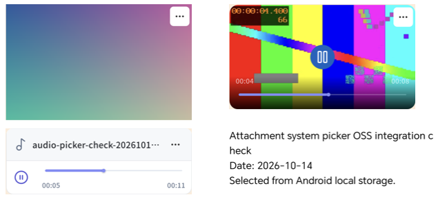

# SaaS 日填写上传保留 HTTP 和 HTTPS 地址

2026-11-17。日填写的图片、视频、音频和附件上传完成后接受 HTTP 或 HTTPS。正文保存上传结果的原地址，包含协议、端口、路径和查询参数。视频封面遵循同样的规则。上传与打开校验要求地址带主机且无内嵌凭据，保存仍拒绝本地或临时媒体地址。

## 验证

- 修复前，四类上传回归均复现 HTTP 被改写为 HTTPS。修复后验证原协议、图片处理参数、视频封面、端口和转义查询参数，以及原有 HTTPS 地址、非法地址、取消和迟到结果。
- 成果导向和工作成果使用测试服务给四类媒体先插入 HTTPS 地址，再换成 HTTP 地址。测试核对插入、替换、撤销、保存和重开时使用的地址。
- 上传服务及正文校验 17 项和页面流程 2 项均通过。四个修改的 Dart 文件通过格式与静态分析检查，两个仓库的 `git diff --check` 均通过。
- Android 和 iOS SaaS 宿主已有 HTTP 加载配置。iOS 本轮仅核对宿主配置。

## Android 真机复验

2026-11-17，荣耀 X70（MTN-AN00）、Android 16、SaaS PRE。重新构建并覆盖安装 2.3.6 Android Debug 包。测试环境的四类媒体域名均配置为 HTTP。

| 项目 | 实测结果 |
| --- | --- |
| PNG 图片 | 在原「工作成果」测试记录中用 `common-login-check-20261014.png` 替换已有图片。保存前与退出后从首页重开时的完整 `http://` 地址逐字一致，包含 `x-oss-process` 查询参数。重开后图片完整显示。从 HTTP 地址取回的原图为 33,105 字节，SHA-256 与选择的手机原图一致。 |
| MP4 视频 | 经系统选择器上传 8 秒合成视频，从原 HTTP 地址取回的 182,201 字节与上传文件一致。真机正文内视频画面和计时推进到 `00:08 / 00:08`。键盘展开时点击视频会收起键盘，收起后从稳定画面点击播放。 |
| MP3 音频 | 经系统选择器上传 `audio-picker-check-20261014.mp3`，HTTP 回读的 96,592 字节与手机原文件一致。真机正文依次显示 `00:01`、`00:05`、`00:10` 和 `00:11 / 00:11`，完成后恢复播放按钮。 |
| TXT 附件 | 经系统选择器上传 `attachment-picker-check-20261014.txt`，从「下载或打开附件 → 打开」进入 Android 查看器，显示完整测试正文。HTTP 响应、Android 下载缓存与手机源文件的 101 字节完全一致。 |

PNG 替换保存在原测试记录。音频、视频和附件在临时草稿中验证后放弃该草稿。再次重开时，已保存的 PNG 正常显示，临时媒体块已清理。

截图上排从左到右为图片重开和视频播放，下排为音频播放和系统查看器显示的 TXT 内容。

